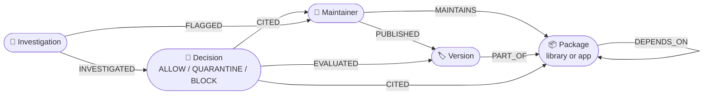
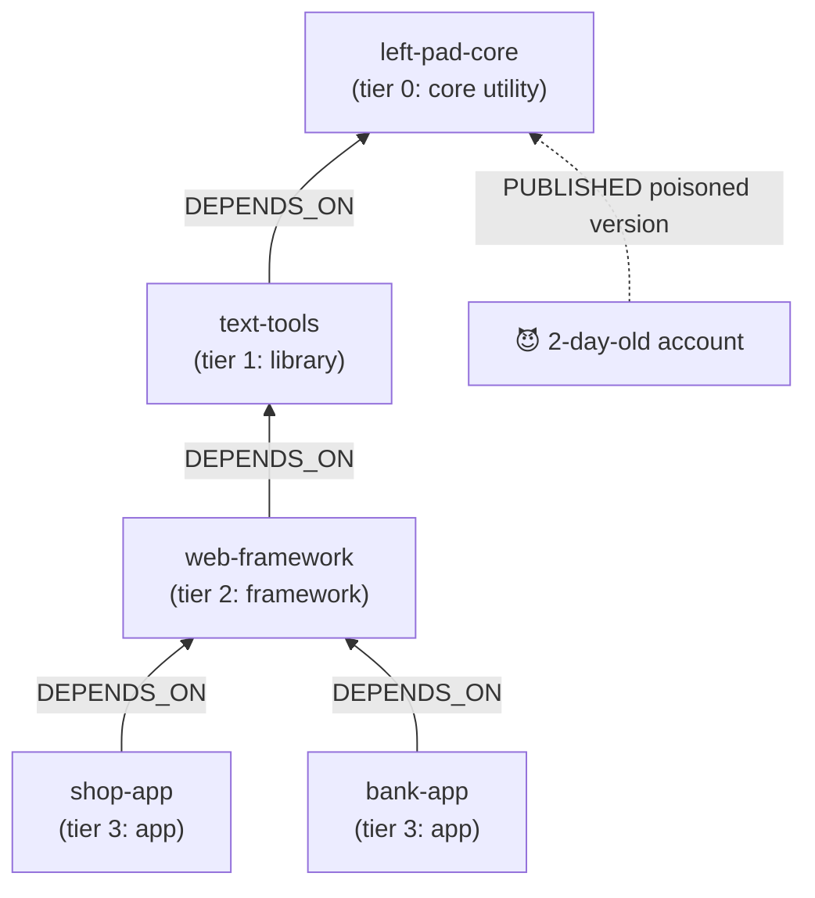

# 🛡️ GraphShield

A graph-native **gatekeeper agent** I built to stop software supply-chain attacks before a malicious release ever reaches production.

**Track:** Agents That Act on Connected Data (also entering: Agent Memory and Coordination)

## The problem

Modern apps pull in hundreds of transitive dependencies. Attackers exploit this by targeting small, deeply nested utility packages with inactive maintainers. They take over the account (or get added as a "helpful" co-maintainer) and push a poisoned version that thousands of downstream apps install automatically. Real-world examples include `event-stream` (2018) and `xz-utils` (2024).

I wanted to solve this structurally rather than relying on reactive code scans after the code is already shipped.

## What I built

Whenever a new release is published, it triggers my **Gatekeeper agent**, which directly reasons over the registry graph I modeled in FalkorDB:

1. **Identify** who published what.
2. **Score maintainer trust**: evaluate account age, verification status, MFA, and how long they have maintained *this specific* package.
3. **Propagate trust**: check if established, verified maintainers vouch for this account through co-maintainership on *other* packages.
4. **Compute the blast radius**: walk `DEPENDS_ON*1..5` upstream to count every package and app that would pull in this version.
5. **Trace the attack paths**: map the deepest app → … → package chains.
6. **Recall memory**: pull earlier agent decisions regarding this maintainer or package.
7. **Decide and record**: output `ALLOW` / `QUARANTINE` / `BLOCK`, and write that verdict back into the graph as a `:Decision` node linked to its supporting evidence.

Every step captures the exact Cypher query I executed, its parameters, execution runtime, and returned rows. This ensures **every verdict is auditable** back to the underlying graph facts.

I deliberately made the Gatekeeper deterministic: given the same graph facts, it will always return the exact same verdict.

### The Investigator agent (LLM)

When my Gatekeeper issues a `BLOCK` or `QUARANTINE`, it leaves the decision open in the graph (`needs_investigation: true`). To handle deeper analysis, I created a secondary **Investigator agent** (`graphshield/investigator.py`).

It runs on any OpenAI-compatible LLM API (I configured Groq with `openai/gpt-oss-120b` as the default free option, but it also supports Google Gemini, Hugging Face, or local Ollama instances):

- **Safe graph traversal**: it explores the graph by generating its own Cypher queries, but I route them strictly through `GRAPH.RO_QUERY` so FalkorDB rejects any accidental or malicious write attempts.
- **Campaign discovery**: it looks for broader campaign footprints: what else the compromised account can publish, staged follow-up packages, earlier flags, and exposed apps.
- **Targeted actions**: I gave it a single, tightly constrained write tool (`flag_maintainer`) to flag suspicious accounts.
- **Audit trail**: it concludes by calling `submit_report`, which writes an `:Investigation` report node (severity, findings, packages at risk, recommended actions) directly linked to the decision and flagged accounts.

### Inter-agent coordination via graph memory

Instead of having the two agents call each other directly, I designed them to coordinate asynchronously through shared graph state:

```
Gatekeeper   -> writes (:Decision {needs_investigation: true})
Investigator -> reads open decisions, writes (:Investigation)-[:INVESTIGATED]->(:Decision),
                sets Maintainer.flagged, and links (:Investigation)-[:FLAGGED]->(:Maintainer)
Gatekeeper   -> reads Maintainer.flagged on that account's next release (+30 risk, citing the reason)
```

I trace every tool call the Investigator makes using the exact same format as the Gatekeeper.

## Graph map



How an attack spreads through the registry, and how far the Gatekeeper looks:



The blast radius query starts at the poisoned package and follows `DEPENDS_ON` backwards up to 5 hops to find every app that would install it. (Package names in this picture are illustrative.)

## Graph data model

I designed this schema to track the full lifecycle of maintainers, packages, and agent decisions:

```
(:Maintainer {handle, created_at, last_active_at, verified, mfa})
    -[:MAINTAINS {since}]->  (:Package {name, kind: 'app'|'library', tier, weekly_downloads})
    -[:PUBLISHED {at}]->     (:Version {id, number, published_at, has_install_script, status})

(:Version)-[:PART_OF]->(:Package)
(:Package)-[:DEPENDS_ON]->(:Package)          // dependent -> dependency

(:Decision {id, verdict, risk, impact, reasons, at, needs_investigation})
    -[:EVALUATED]->(:Version)
    -[:CITED]->(:Maintainer), (:Package)      // agent memory + evidence

(:Investigation {id, severity, headline, summary, findings, actions, packages_at_risk, model, at})
    -[:INVESTIGATED]->(:Decision)
    -[:FLAGGED]->(:Maintainer)                // sets Maintainer.flagged / flag_reason
```

I added `Version.prev_active_at` to record when the publisher was last active prior to that release, which is how my Gatekeeper detects dormant accounts waking up.

I stored all timestamps as epoch milliseconds so they evaluate natively against Cypher's `timestamp()` function.

**Data generation:** I wrote `graphshield/seed.py` to generate a synthetic registry containing 5 core utilities → 15 libraries → 30 frameworks → 100 apps, managed by 41 maintainers across roughly 370 package versions. In my dataset, `left-pad-core` acts as a deep utility maintained by an old, inactive account without MFA.

## Core Cypher queries

I organized all database queries inside `graphshield/queries.py`. Here are the key patterns my system relies on:

**1. Blast radius (variable-length path traversal)**

```cypher
MATCH (dep:Package)-[:DEPENDS_ON*1..5]->(t:Package {name: $pkg})
WITH collect(DISTINCT dep) AS deps
RETURN size(deps) AS total_dependents,
       size([d IN deps WHERE d.kind = 'app']) AS apps_affected,
       reduce(s = 0, d IN deps | s + d.weekly_downloads) AS weekly_downloads_at_risk
```

**2. Trust propagation via co-maintainers**

```cypher
MATCH (m:Maintainer {handle: $handle})-[r:MAINTAINS]->(p:Package)<-[:MAINTAINS]-(peer:Maintainer)
WHERE p.name <> $pkg AND peer.handle <> m.handle
  AND timestamp() - r.since > 90 * 86400000
  AND peer.verified = true
  AND timestamp() - peer.created_at > 365 * 86400000
RETURN count(DISTINCT peer) AS vouching_peers
```

**3. Attack path extraction**

```cypher
MATCH path = (a:Package {kind: 'app'})-[:DEPENDS_ON*1..5]->(t:Package {name: $pkg})
RETURN [n IN nodes(path) | n.name] AS chain, length(path) AS hops
ORDER BY hops DESC LIMIT 5
```

**4. Agent memory (write and recall)**

```cypher
MATCH (m:Maintainer {handle: $handle})-[:PUBLISHED]->(v:Version {id: $vid})-[:PART_OF]->(p:Package)
CREATE (d:Decision {id: $did, verdict: $verdict, risk: $risk, impact: $impact,
                    reasons: $reasons, at: timestamp()})
CREATE (d)-[:EVALUATED]->(v), (d)-[:CITED]->(m), (d)-[:CITED]->(p)
SET v.status = $status
```

## Scoring logic

I implemented a clear risk scoring model based on weighted signals:

| Signal | Risk weight |
|---|---|
| Account age < 30 days (or < 90 days) | +35 (+15) |
| Account not verified / no MFA | +10 each |
| Maintainer of this specific package for < 30 days | +15 |
| No vouching peers (co-maintainership must be > 90 days old) | +10 |
| Account dormant ≥ 180 days before this release (takeover risk) | +20 |
| Version introduces an install script | +15 |
| Publisher flagged in previous Gatekeeper memory | +20 |
| Account flagged by the Investigator agent | +30 |

**Impact** is derived directly from the blast radius (≥ 50 apps = Critical, ≥ 10 apps = High).

**Verdict rules:**

- **BLOCK**: risk score ≥ 50 AND impact is High/Critical.
- **QUARANTINE**: risk score ≥ 50, OR risk score ≥ 30 with Critical impact.
- **ALLOW**: passed all risk/impact thresholds.

## Setup

Requirements: Python 3.10+ and Docker (or a FalkorDB Cloud instance).

```bash
# 1. Start FalkorDB locally (database on :6379, Browser UI on :3000)
docker compose up -d

# 2. Set up Python environment
python -m venv .venv
source .venv/bin/activate             # On Windows: .venv\Scripts\activate
pip install -r requirements.txt

# 3. Seed the synthetic registry and run the UI
python -m graphshield.seed
streamlit run app.py
```

**Investigator agent setup:** copy `.env.example` to `.env`, set your preferred `LLM_PROVIDER`, and supply an API key (e.g., a free Groq key from console.groq.com).

**FalkorDB Cloud support:** set `FALKORDB_HOST`, `FALKORDB_PORT`, `FALKORDB_USERNAME`, and `FALKORDB_PASSWORD` in your `.env`.

## Live demo workflow

1. **Reset state:** click **♻️ Seed / reset registry**.
2. **Test normal flow:** run **✅ Legit release**. An established maintainer ships a patch update, and the Gatekeeper evaluates it as **ALLOW**.
3. **Test new-account attack:** run **🚨 New-account attack**. A 2-day-old, unverified account gets added to `left-pad-core` and publishes a version containing an install script. The Gatekeeper issues a **BLOCK**, highlights that all 100 apps are at risk, and outputs every query executed with execution metrics.
4. **Run AI investigation:** click **🔎 Investigate this case**. The Investigator agent generates its own Cypher queries, discovers that the same account was quietly granted access to `tiny-utf8`, flags the account, and files a report.
5. **Demonstrate agent coordination:** run **🔁 Attacker strikes again**. The Gatekeeper blocks the `tiny-utf8` release instantly, citing the flag written by the Investigator agent in step 4.
6. **Test dormant account takeover:** reset the graph, then run **🕵️ Account takeover**. The original maintainer of `left-pad-core` (dormant for 700 days, no MFA) publishes an install script. Even without a new account, the Gatekeeper returns **BLOCK** by weighing dormancy, missing MFA, lack of peer vouching, and the install script.

## Why I chose a graph database

Answering "which applications transitively depend on this package through any number of hops?" is fundamentally a variable-length path traversal problem.

In FalkorDB, I can express this cleanly as a single `-[:DEPENDS_ON*1..5]->` path pattern evaluated efficiently over sparse adjacency matrices. Doing this in a traditional SQL database requires recursive CTEs whose cost grows with every additional join level. By combining graph traversals, trust propagation, and persistent memory nodes directly in FalkorDB, the system has a rich, connected graph to reason over. Remove FalkorDB and the agents have nothing to reason over.

## Project structure

```
graphshield/
├── db.py            # Environment-configured FalkorDB connection
├── queries.py       # Centralized Cypher query repository
├── seed.py          # Synthetic registry generator
├── simulate.py      # Event injector (attack, takeover, repeat, legit)
├── agent.py         # Gatekeeper agent (traces steps -> scores -> writes Decision nodes)
└── investigator.py  # Investigator LLM agent (generates Cypher -> flags -> writes Investigation nodes)
app.py               # Streamlit dashboard (PyVis graph visualization, traces, logs)
```

## Data and AI disclosure

**Data:** all package, maintainer, and version records are 100% synthetic, generated programmatically via `seed.py`. No actual personal or proprietary registry data was used.

**AI assistance:** I used Claude Code (Anthropic) as an AI pair-programmer during development. I designed the system architecture, graph schema, scoring mechanics, and security strategies, and I reviewed, tested, and verified all code in this repository.
